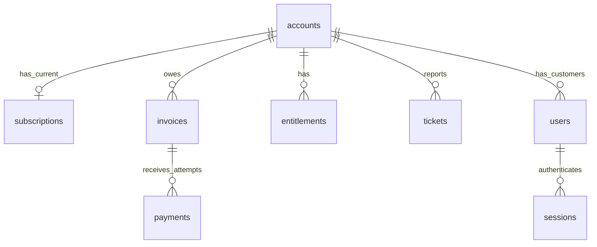

# Architecture — Parts 1–8

```text
Interactive API docs / HTTP client
    → FastAPI request validation + bearer-session dependency
    → database session lookup and trusted user identity
    → ownership / operator permission checks
    → account / invoice / ticket endpoints
    → SQLite connections with foreign keys and transactions
    → persistent synthetic records

Controlled Markdown policies
    → metadata validation and token-bounded chunks
    → local sentence encoder (384-dimensional vectors)
    → immutable SQLite policy index snapshot

Authenticated policy query
    → effective-date/family filtering
    → BM25 + exact dense similarity
    → reciprocal rank fusion
    → source passages and ranking components

Authenticated answer request
    → optional owner-scoped conversation lookup
    → bounded recent completed history + fresh policy retrieval
    → instruction + question + current passages + unverified history
    → Gemini structured-output generation
    → schema / source-ID / exact-quote checks
    → persist accepted turn in SQLite
    → checked answer text and provenance
```



Authentication and authorization are implemented. Operator users have no customer account and have explicit cross-account billing/investigation permissions, but conversations remain private to their creator. Shared policy retrieval, Gemini answers, account investigation and simulated actions are implemented. A database relationship alone does not authenticate a caller.

The embedding encoder runs locally and retrieves passages; Gemini is a separate remote policy-answer generator. Account tools are used by the bounded investigation graph and exposed separately through MCP. They are not connected to an autonomous Gemini tool planner. Raw provider text is buffered before validation; streaming clients see progress, then accepted text. Checks establish citation integrity, not semantic entailment. Recent history is persisted text selected into a new request, not model training. The application uses optimistic conversation revisions and a unique running-turn constraint; startup recovery assumes one server worker.

```text
Customer / operator browser
  → expiring session + trusted role/account identity
  → investigation API
  → LangGraph: inspect records → retrieve policies → assess evidence → persist
  → ticket + immutable historical findings + pending proposals

Operator decision → approved / rejected (no execution)
Operator execution + idempotency key
  → BEGIN IMMEDIATE
  → cached-request lookup
  → current account and policy revalidation
  → simulated refund ledger OR entitlement upsert
  → proposal state + ticket reconciliation + audit event + cached response
  → COMMIT

External MCP client → stdio FastMCP → existing bearer-session HTTP API
  → the same read-only account/billing tools (no action tools)
```

Static HTML/CSS/JavaScript is served from FastAPI. SQLite holds relational state, vectors, conversations, case steps, proposals, refunds, idempotency results and audit events. The LangGraph run is bounded and uses direct Python tool calls; persistence is application-managed, not a LangGraph checkpoint backend. A real payment provider, distributed job queue and production authentication provisioning are out of scope.
